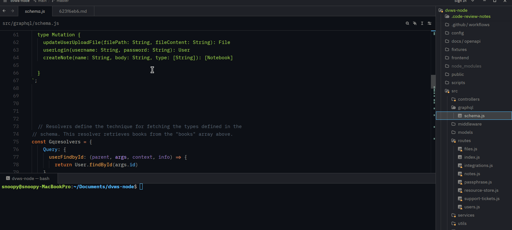

# Code Review Notes for Zed



Keep code review notes alongside your code and import security findings from SARIF reports. Notes are Markdown files in `.code-review-notes/` at the project root.

## Install

Install [Rust](https://rustup.rs), then run this from the repository root:

```sh
cargo install --path code-review-notes
```

In Zed, run **zed: install dev extension** and select `zed-extension/` (extension ID `code-review-notes-lsp`). Trust the project if Zed opens it in Restricted Mode.

**Required: enable the server for each language where you want review notes.** Installing the extension alone does not enable its code actions. Run **zed: open settings file** and add the server key `code-review-notes` for your languages.

**For `.sarif` import in Zed, add both settings:** enable `code-review-notes` for `Plain Text` under `languages`, and map the `sarif` file type to `Plain Text` under `file_types`. Without the file type mapping, Zed may open `.sarif` as **Unknown**, where the server cannot offer an import action. This example also enables notes in source files and import from `.json` reports:

```json
{
  "file_types": { "Plain Text": ["sarif"] },
  "languages": {
    "JavaScript": { "language_servers": ["code-review-notes", "..."] },
    "TypeScript": { "language_servers": ["code-review-notes", "..."] },
    "Python": { "language_servers": ["code-review-notes", "..."] },
    "JSON": { "language_servers": ["code-review-notes", "..."] },
    "Plain Text": { "language_servers": ["code-review-notes", "..."] }
  }
}
```

Merge the `file_types` and `languages` entries into your existing settings; keep only the languages you use. The `"..."` keeps Zed's other language servers. **Use `Plain Text` for `.sarif` files, not `SARIF`:** this extension no longer defines a SARIF language. After saving settings, close and reopen the report and check that its language label says **Plain Text**. You can also select **Plain Text** from the language picker for an individual report instead of adding the file type mapping. Use `JSON` for `.json` scanner reports. See [language support](docs/reference.md#language-support) for details. After changing Rust code, reinstall the CLI and restart the language server; after changing `zed-extension/`, reinstall the dev extension.

## Use in Zed

Right-click in a code file and choose **Show Code Actions**:

| Action | Use |
| --- | --- |
| **Add review note** | Create a note for the selected lines. Edit its Markdown body and save. |
| **Mark Open / Issue / Question / Note / OK** | Set the status of a note on the current line. |
| **Accept edited code** | Confirm a note's code after it changes. |
| **Open review note** / **Delete review note** | Open or remove a note on the current line. |

Notes follow their code through edits and moves. If the code changes substantially, the note is marked *changed*; if the code disappears, it is marked *stale*. `cmd-t` searches notes, `cmd-shift-m` lists Open and Issue notes, and `F8` / `shift-F8` jumps between notes in a file.

New notes start as **Note**. Imported findings start as **Open**. **Open** appears as a warning; **Issue** appears as an error. Run `code-review-notes init` to create `.code-review-notes/config.toml` if you want different statuses. See [configuration](docs/reference.md#statuses).

## Import scanner findings

Use either method in the project you scanned:

- **In Zed:** Enable `code-review-notes` for **Plain Text** and associate `.sarif` files with it using `"file_types": { "Plain Text": ["sarif"] }`; there is no `SARIF` settings entry. Alternatively, select **Plain Text** in the language picker when the file shows **Unknown**. Enable **JSON** separately for SARIF, Brakeman, or GitLab `.json` reports. Right-click *inside the report editor* → **Show Code Actions** → **Import into Code Review Notes**. This extension does not associate `.sarif` with a SARIF language or supply its JSON highlighting.
- **CLI:** From the project root, run:

  ```sh
  code-review-notes import path/to/report.sarif
  ```

Both methods create one note per finding with a source file and line. Re-importing does not duplicate findings or reset their statuses. The CLI can also mark findings missing from a later full scan as resolved:

```sh
code-review-notes import --resolve-missing path/to/report.sarif
```

Use `--resolve-missing` only with a full scan; a partial scan may incorrectly mark findings resolved. See [scanner formats and path handling](docs/reference.md#scanner-reports).

## CLI

```sh
code-review-notes list                   # notes and their statuses
code-review-notes list --status issue    # filter by status; also --tag cwe-89
code-review-notes stats                  # counts by status and scanner
code-review-notes prune                  # find notes whose code is gone; --yes deletes them
code-review-notes export -o review.md    # Markdown report
code-review-notes export --format sarif  # also json or gitlab-issues
```

See [export details](docs/reference.md#exports).

## Zed agent

Agent access is optional and requires [adding the CLI as a local MCP server](docs/reference.md#zed-agent) in Zed. The extension does not set this up automatically. Once configured, the agent can list, read, add, and change notes. Review its edits, especially when notes come from an untrusted repository.

## Troubleshooting

- **No import action for minified SARIF:** Zed disables language server features when a line exceeds its default limit of 20,000 characters. In **zed: open settings**, set `"global_lsp_settings": { "max_buffer_line_length": 400000 }` if that exceeds your report's longest line. Reopen the file. You can also pretty-print the report.
- **No code actions:** First check that the file's current language explicitly enables `code-review-notes` in Zed settings. Installing the extension alone does not start this opt-in server. Then trust the project, confirm the `code-review-notes` binary is installed, and check **dev: open language server logs** → *Code Review Notes*. For an unrecognized file type, see [language support](docs/reference.md#language-support).
- **Extension build fails:** See [build troubleshooting](docs/reference.md#build-troubleshooting).

## Safety

Notes and scanner reports are untrusted input. The extension rejects paths outside the project and does not read arbitrary files during export. Anyone with commit access can add a note that claims to be from a scanner or is already marked OK; check `git log -- .code-review-notes` before trusting shared notes. GitLab secret-detection findings may put the secret in a note and its exports. See [security details](docs/reference.md#security-details).

## License

MIT, see [LICENSE](LICENSE).
