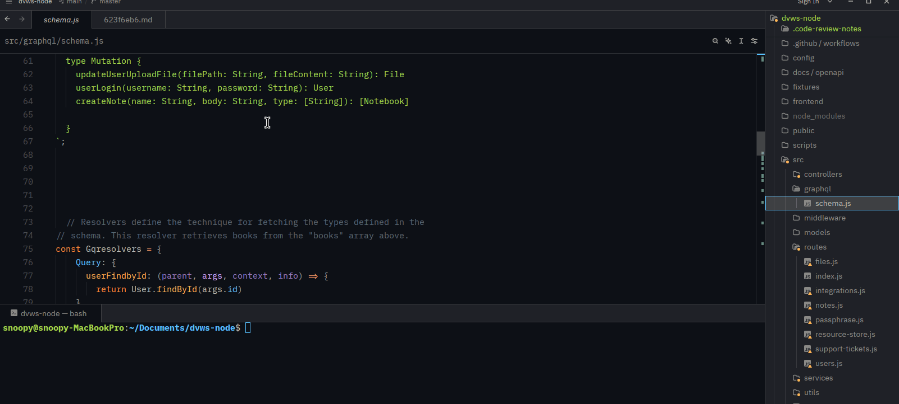
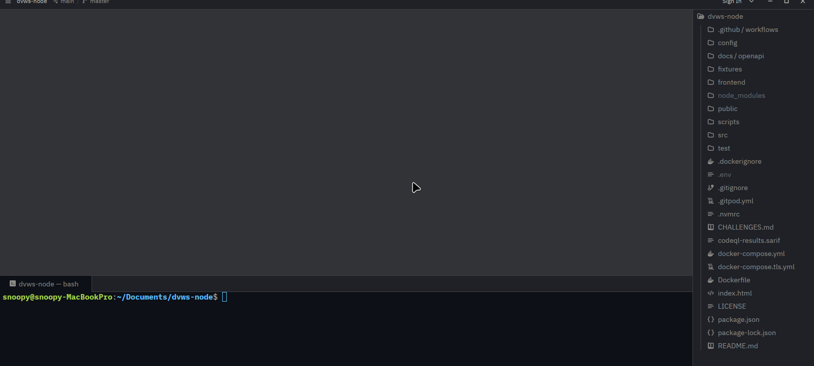

# Code Review Notes for Zed



Add review notes to code in Zed and import findings from SARIF, Brakeman, and GitLab security reports. Notes are Markdown files in `.code-review-notes/` at the project root.

## Install

Install [Rust](https://rustup.rs), then run this from the repository root:

```sh
cargo install --path code-review-notes
```

In Zed, run **zed: install dev extension** and select `zed-extension/`. Trust the project if Zed opens it in Restricted Mode. After changing Rust code, reinstall the CLI and restart the language server; after changing `zed-extension/`, reinstall the dev extension.

## Use in Zed

Right-click in a code file and choose **Show Code Actions**:

| Action | Use |
| --- | --- |
| **Add review note** | Create a note for the selected lines. Edit its Markdown body and save. |
| **Mark Open / Issue / Question / Note / OK** | Set the status of a note on the current line. |
| **Accept edited code** | Confirm a note's code after it changes. |
| **Open review note** / **Delete review note** | Open or remove a note on the current line. |

Notes follow their code through edits and moves. If the code changes substantially, the note is marked *changed*; if the code disappears, it is marked *stale*. `cmd-t` searches notes, `cmd-shift-m` lists Open and Issue notes, and `F8` / `shift-F8` jumps between notes in a file.

New notes start as **Note**. Imported findings start as **Open**. **Open** appears as a warning; **Issue** appears as an error. Run `code-review-notes init` to create `.code-review-notes/config.toml` if you want different statuses. See [configuration](docs/reference.md#statuses).

## Import scanner findings



Use either method in the project you scanned:

- **In Zed:** Open the report (`.sarif`, or a SARIF, Brakeman, or GitLab `.json` file). Right-click *inside the report editor* → **Show Code Actions** → **Import into Code Review Notes**.
- **CLI:** From the project root, run:

  ```sh
  code-review-notes import path/to/report.sarif
  ```

Both methods create one note per finding with a source file and line. Re-importing does not duplicate findings or reset their statuses. The CLI can also mark findings missing from a later full scan as resolved:

```sh
code-review-notes import --resolve-missing path/to/report.sarif
```

Use `--resolve-missing` only with a full scan; a partial scan may incorrectly mark findings resolved. See [scanner formats and path handling](docs/reference.md#scanner-reports).

## CLI

```sh
code-review-notes list                   # notes and their statuses
code-review-notes list --status issue    # filter by status; also --tag cwe-89
code-review-notes stats                  # counts by status and scanner
code-review-notes prune                  # find notes whose code is gone; --yes deletes them
code-review-notes export -o review.md    # Markdown report
code-review-notes export --format sarif  # also json or gitlab-issues
```

See [export details](docs/reference.md#exports).

## Zed agent

Agent access is optional and requires [adding the CLI as a local MCP server](docs/reference.md#zed-agent) in Zed. The extension does not set this up automatically. Once configured, the agent can list, read, add, and change notes. Review its edits, especially when notes come from an untrusted repository.

## Troubleshooting

- **No import action for minified SARIF:** Zed disables language server features when a line exceeds its default limit of 20,000 characters. In **zed: open settings**, set `"global_lsp_settings": { "max_buffer_line_length": 400000 }` if that exceeds your report's longest line. Reopen the file. You can also pretty-print the report.
- **No code actions:** Trust the project and check **dev: open language server logs** → *Code Review Notes*. Confirm the `code-review-notes` binary is installed. For an unrecognized file type, see [language support](docs/reference.md#language-support).
- **Extension build fails:** See [build troubleshooting](docs/reference.md#build-troubleshooting).

## Safety

Notes and scanner reports are untrusted input. The extension rejects paths outside the project and does not read arbitrary files during export. Anyone with commit access can add a note that claims to be from a scanner or is already marked OK; check `git log -- .code-review-notes` before trusting shared notes. GitLab secret-detection findings may put the secret in a note and its exports. See [security details](docs/reference.md#security-details).

## License

MIT, see [LICENSE](LICENSE).
